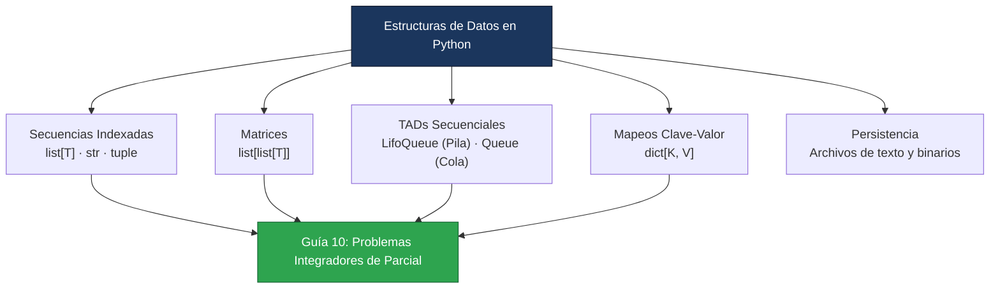

<div align="center">

# Algoritmos y Estructuras de Datos I
**Introducción a la Programación — Departamento de Computación, FCEyN (UBA)**

[](#1-programación-funcional-haskell)
[](#2-programación-imperativa-python)
[](#entorno-y-ejecución)
[](#información-académica)

[Recorrido de la Materia](#recorrido-de-la-materia) ·
[Estructura](#estructura-del-repositorio) ·
[Contenidos](#contenidos-por-módulo) ·
[Funciones Permitidas y Prohibidas](#lineamientos-de-cátedra-para-evaluaciones) ·
[Ejecución](#entorno-y-ejecución)

</div>

---

## Descripción general

Repositorio académico con las resoluciones de guías prácticas, apuntes de laboratorio, suites de tests unitarios y modelos de examen de **Algoritmos y Estructuras de Datos I**.

El curso aborda la resolución de problemas a partir de especificaciones formales (contratos con precondiciones `requiere` y postcondiciones `asegura`) divididos en dos unidades troncales:

- **Programación Funcional (`Haskell`):** Funciones puras, tipos básicos, recursión sobre enteros y listas, polimorfismo y *pattern matching*.
- **Programación Imperativa (`Python`):** Estado y control de flujo, pasaje de parámetros (`in`, `out`, `inout`), secuencias, matrices, tipos abstractos de datos (`LifoQueue`, `Queue`), diccionarios, archivos y testing automatizado con `unittest`.

---

## Recorrido de la materia

```mermaid
flowchart LR
    subgraph Funcional ["1. Paradigma Funcional (Haskell)"]
        direction LR
        G3["Guía 3<br/>Tipos y Tuplas"] --> G4["Guía 4<br/>Recursión Entera"]
        G4 --> G5["Guía 5<br/>Recursión en Listas"]
        G5 --> P1(["1.er Parcial<br/>Modelos Resueltos"])
    end

    subgraph Imperativo ["2. Paradigma Imperativo (Python)"]
        direction LR
        G6["Guía 6<br/>Estado y Ciclos"] --> G7["Guía 7<br/>Listas y Matrices"]
        G7 --> G8["Guía 8<br/>Pilas, Colas, Dicts y Archivos"]
        G8 --> G10(["Guía 10<br/>Integración 2.º Parcial"])
    end

    Funcional ==> Imperativo

    style Funcional fill:#f5f3ff,stroke:#5e5086,stroke-width:1.5px,color:#1f2937
    style Imperativo fill:#eff6ff,stroke:#3776ab,stroke-width:1.5px,color:#1f2937
    style P1 fill:#5e5086,stroke:#4338ca,color:#ffffff
    style G10 fill:#3776ab,stroke:#1d4ed8,color:#ffffff
```



---

## Estructura del repositorio

```text
algoritmos_1/
├── haskell/
│   └── Practicas/
│       ├── guia3/                      # Guía 3: Introducción a Haskell, tuplas y pattern matching
│       ├── guia4/                      # Guía 4: Recursión sobre números enteros
│       └── guia5/                      # Guía 5: Recursión estructural sobre listas
│
├── python/
│   └── guias/
│       ├── guia6/                      # Guía 6: Introducción al paradigma imperativo
│       ├── guia7/                      # Guía 7: Secuencias, listas y matrices (+ unittest)
│       ├── guia8/                      # Guía 8: Pilas, colas, diccionarios y archivos (+ unittest)
│       └── guia10/                     # Guía 10: Ejercicios integradores tipo 2.º parcial
│
└── clases/
    ├── haskell/
    │   ├── Practicas/                  # Ejercicios desarrollados en clases prácticas
    │   ├── parciales/                  # Modelos de parcial resueltos (2C2023, 1C2024, 2C2024, 1C2025)
    │   ├── funcioneshs.hs              # Compendio de funciones auxiliares y repaso
    │   ├── SolucionT1(1).hs            # Resolución de tema de evaluación
    │   └── nota_practica_ip_26-08.txt  # Notas de clase práctica
    └── python/
        ├── clase28_9.py                # Pruebas unitarias con unittest (ejemplo triángulos)
        ├── clase5_10python.py          # Ejercicios de secuencias y ciclos
        ├── clase7_10.py                # Práctica sobre listas y mutabilidad
        ├── clase19_10.py               # Práctica sobre TAD Pila (LifoQueue) y Cola (Queue)
        ├── claseDiccionarios.py        # Práctica sobre diccionarios y lectura/escritura de archivos
        ├── test.py                     # Casos de prueba adicionales de clase
        └── atajos_python               # Referencia rápida de sintaxis y comandos
```

---

## Contenidos por módulo

### 1. Programación Funcional (Haskell)

Resoluciones disponibles en [`haskell/Practicas/`](./haskell/Practicas/):

| Unidad | Archivo | Temas principales | Estado |
| :--- | :--- | :--- | :---: |
| **Guía 3** | [`guia3.hs`](./haskell/Practicas/guia3/guia3.hs) | Tipos básicos, guardas, *pattern matching* y operaciones con tuplas | `Completada` |
| **Guía 4** | [`guia4.hs`](./haskell/Practicas/guia4/guia4.hs) | Recursión sobre enteros, divisibilidad, dígitos y sumatorias | `Completada` |
| **Guía 5** | [`guia5.hs`](./haskell/Practicas/guia5/guia5.hs) | Recursión sobre listas, polimorfismo, orden y cadenas (`[Char]`) | `Completada` |
| **Parciales** | [`clases/haskell/parciales/`](./clases/haskell/parciales/) | Exámenes resueltos: [`2C2023`](./clases/haskell/parciales/parcial2C2023.hs), [`1C2024`](./clases/haskell/parciales/1C2024.hs), [`2C2024`](./clases/haskell/parciales/parcial2C2024.hs), [`1C2025`](./clases/haskell/parciales/parcial1C2025.hs) y [`ejerciciosTipoParcial`](./clases/haskell/parciales/ejerciciosTipoParcial.hs) | `Completados` |

### 2. Programación Imperativa (Python)

Resoluciones y suites de pruebas disponibles en [`python/guias/`](./python/guias/):

| Unidad | Código fuente | Suite de tests | Temas principales | Estado |
| :--- | :--- | :--- | :--- | :---: |
| **Guía 6** | [`guia6.py`](./python/guias/guia6/guia6.py) | — | Funciones, tipado estático, condicionales y ciclos `while` / `for` | `Completada` |
| **Guía 7** | [`guia7.py`](./python/guias/guia7/guia7.py) | [`tests_guia7.py`](./python/guias/guia7/tests_guia7.py) | Listas, matrices, mutabilidad, aliasing y pasaje `in` / `out` / `inout` | `Completada` |
| **Guía 8** | [`guia8.py`](./python/guias/guia8/guia8.py) | [`tests_guia8.py`](./python/guias/guia8/tests_guia8.py) | TAD Pila (`LifoQueue`), TAD Cola (`Queue`), diccionarios y archivos | `Completada` |
| **Guía 10** | [`guia10.py`](./python/guias/guia10/guia10.py) | — | Integración para el 2.º Parcial: stock, grillas, salas de escape, torneo de gallinas, colas VIP, palíndromos, Ta-Te-Ti y registros epidemiológicos | `Completada` |

### Mapa de estructuras trabajadas en Python (Guías 6 a 10)



---

## Lineamientos de cátedra para evaluaciones

> [!IMPORTANT]
> En las instancias de evaluación parcial solo se permite el uso de las primitivas detalladas a continuación. Cualquier otra función o método **debe ser implementado manualmente** como función auxiliar; de lo contrario, el ejercicio queda anulado.

### 1. Haskell

#### Primitivas permitidas

| Categoría | Funciones y operadores |
| :--- | :--- |
| **División entera** | `mod :: Integral a => a -> a -> a` · `div :: Integral a => a -> a -> a` |
| **Tuplas** | `fst :: (a, b) -> a` · `snd :: (a, b) -> b` |
| **Listas** | `(:) :: a -> [a] -> [a]` · `(++) :: [a] -> [a] -> [a]` · `head :: [a] -> a` · `tail :: [a] -> [a]` |
| **Matemáticas y conversión** | `sqrt :: Floating a => a -> a` · `fromIntegral` · `fromInteger` · Operadores: `+`, `-`, `*`, `/`, `**`, `^` |
| **Lógica y comparación** | `not :: Bool -> Bool` · Operadores: `&&`, `||`, `==`, `/=`, `>`, `<`, `>=`, `<=` |
| **Definiciones locales** | Uso de cláusulas `where` |

#### Funciones y construcciones inválidas (prohibidas salvo implementación propia)

| Construcción no permitida | Alternativa requerida en el parcial |
| :--- | :--- |
| Condicional `if ... then ... else ...` | Utilizar **guardas** (`\| condicion = ... \| otherwise = ...`) o ***pattern matching*** |
| Funciones de listas del `Prelude` (`length`, `elem`, `reverse`, `init`, `last`, `take`, `drop`, `(!!)`) | Implementarlas recursivamente con `head`, `tail` y `(:)` |
| Orden superior y plegados (`map`, `filter`, `foldr`, `foldl`, `zip`, `any`, `all`) | Desarrollar la recursión explícitamente |
| Funciones numéricas (`abs`, `max`, `min`, `even`, `odd`, `gcd`, `lcm`, `sum`, `maximum`, `minimum`) | Definirlas como funciones auxiliares con guardas y `mod` / `div` |
| Listas por comprensión (`[x \| x <- xs]`) y rangos (`[1..n]`) | Construir las listas mediante funciones recursivas |

---

### 2. Python

#### Primitivas y métodos permitidos

| Categoría | Elementos habilitados |
| :--- | :--- |
| **Conversión de tipos** | `int`, `list`, `float`, `str`, `tuple`, `bool` |
| **Estructuras de control** | `if` / `elif` / `else`, `while`, `for ... in range(...)`, `for ... in secuencia` |
| **Rango** | `range(i, f, p)` *(con 1, 2 o 3 parámetros)* |
| **Aritméticas** | `+`, `-`, `*`, `/`, `//`, `%`, `sqrt`, `round`, `floor`, `ceil` |
| **Lógica y comparación** | `and`, `or`, `not`, `==`, `!=`, `>`, `<`, `>=`, `<=` |
| **Secuencias** | Pertenencia (`in`), concatenación (`+`), repetición (`*`), longitud (`len(s)`), índice positivo (`s[i]`) |
| **Listas** | `append(e)`, `insert(p, e)`, `remove(e)`, `index(e)`, `count(e)`, `clear()`, `pop()`, `pop(n)`, `copy()` |
| **Diccionarios** | `items()`, `keys()`, `values()`, `pop(clave)`, `clear()` |
| **TAD Pila (`LifoQueue`)** | `from queue import LifoQueue as Pila` → `Pila()`, `put(e)`, `get()`, `empty()` |
| **TAD Cola (`Queue`)** | `from queue import Queue as Cola` → `Cola()`, `put(e)`, `get()`, `empty()` |
| **Archivos** | `open`, `read`, `readline`, `readlines`, `write`, `writelines`, `close`, `os.path.join()`, `os.path.exists()` |

#### Funciones y construcciones inválidas (prohibidas en parcial)

| Construcción no permitida | Alternativa requerida en el parcial |
| :--- | :--- |
| **Slicing de secuencias** (`s[i:f]`, `s[::-1]`, `s[:]`) | Recorrer con `for` / `while` e indexación positiva `s[i]` |
| **Índices negativos** (`s[-1]`, `s[-i]`) | Acceder mediante `s[len(s) - 1]` o `s[len(s) - i]` |
| **Built-ins de agregación/orden** (`max`, `min`, `sum`, `abs`, `sorted`, `reversed`, `enumerate`, `zip`, `set`) | Implementar función auxiliar iterativa |
| **Métodos de listas no listados** (`.sort()`, `.reverse()`, `.extend()`) | Implementar el algoritmo manualmente o agregar con `.append()` |
| **Métodos de `str`** (`.split()`, `.strip()`, `.replace()`, `.lower()`, `.upper()`, `.join()`, `.find()`) | Recorrer el `str` carácter por carácter mediante un ciclo |
| **Métodos de `dict` no listados** (`.get()`, `.update()`, `.setdefault()`) | Verificar existencia con `clave in d.keys()` y acceder con `d[clave]` |
| **Atributos internos de Pila/Cola** (`.queue`, `.qsize()`) | Desapilar/desencolar en estructura auxiliar con `get()` / `put()` y restaurar el parámetro `in` |
| **Comprensiones y `lambda`** (`[x for x in s]`, `{k: v for ...}`) | Inicializar la estructura vacía y poblarla con un ciclo `for` o `while` |
| **Saltos incondicionales** (`break`, `continue`) | No recomendados; controlar la terminación en la guarda del `while` |
| **Omisión de tipado estático** | Es obligatorio anotar tipos en firmas de funciones y variables locales |

---

## Entorno y ejecución

### Haskell (`GHCi`)

Cargar cualquier guía o parcial en el intérprete interactivo desde la raíz del repositorio:

```bash
ghci haskell/Practicas/guia5/guia5.hs
```

Comandos frecuentes dentro de `GHCi`:
```haskell
:r          -- Recargar el módulo tras guardar cambios
:t funcion  -- Consultar la signatura de tipos de una función
:q          -- Cerrar el intérprete
```

### Python (`unittest`)

Ejecutar las suites de pruebas unitarias de las guías prácticas:

```bash
# Ejecutar tests de la Guía 7 (Listas y matrices)
python3 -m unittest python/guias/guia7/tests_guia7.py -v

# Ejecutar tests de la Guía 8 (Pilas, colas, diccionarios y archivos)
python3 -m unittest python/guias/guia8/tests_guia8.py -v
```

---

## Información académica

- **Materia:** Algoritmos y Estructuras de Datos I (Introducción a la Programación)
- **Institución:** Departamento de Computación — Facultad de Ciencias Exactas y Naturales, Universidad de Buenos Aires (FCEyN - UBA)
- **Cursada:** 2.º Cuatrimestre 2026
