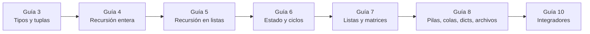

<a id="top"></a>

<div align="center">

# Algoritmos y Estructuras de Datos I

Resoluciones de guías prácticas, ejercicios de clase y modelos de parcial en **Haskell** y **Python**.

[](https://www.haskell.org/)
[](https://www.python.org/)
[](https://numpy.org/)
[](https://docs.python.org/3/library/unittest.html)

[](https://github.com/damianvarela2/algoritmos_1)
[](https://github.com/damianvarela2/algoritmos_1/commits/main)
[](https://github.com/damianvarela2/algoritmos_1)
[](https://github.com/damianvarela2/algoritmos_1/issues)

[Descripción](#-descripción-general) ·
[Estructura](#-estructura-del-repositorio) ·
[Contenido](#-contenido-por-guía) ·
[Requisitos](#-requisitos) ·
[Ejecución](#-ejecución) ·
[Tests](#-tests)

</div>

---

## 📖 Descripción general

Primera materia de programación de la carrera. El repositorio contiene las resoluciones de las guías prácticas, los ejercicios desarrollados en clase y modelos de parcial resueltos.

La cursada recorre dos paradigmas:

- **Funcional, en [Haskell](https://www.haskell.org/):** funciones puras, guardas, *pattern matching*, recursión sobre enteros y listas, polimorfismo.
- **Imperativo, en [Python](https://www.python.org/):** estado y control de flujo, listas y matrices, tipos abstractos de datos (pila y cola), diccionarios, archivos y testing con [`unittest`](https://docs.python.org/3/library/unittest.html).

Los ejercicios se resuelven a partir de especificaciones formales, con precondiciones (`requiere`) y postcondiciones (`asegura`).

> [!NOTE]
> El repositorio se creó después del primer parcial, por eso la numeración de las guías arranca en la 3 y no hay guías 1, 2 ni 9.

---

## 📁 Estructura del repositorio

El repositorio separa las **guías resueltas** (`haskell/`, `python/`) del **material de clase** (`clases/`).

```text
algoritmos_1/
├── haskell/
│   └── Practicas/
│       ├── guia3/guia3.hs          # Tipos, guardas, pattern matching, tuplas
│       ├── guia4/guia4.hs          # Recursión sobre enteros
│       └── guia5/guia5.hs          # Recursión sobre listas
│
├── python/
│   └── guias/
│       ├── guia6/guia6.py          # Introducción al paradigma imperativo
│       ├── guia7/                  # Listas y matrices
│       │   ├── guia7.py
│       │   └── tests_guia7.py
│       ├── guia8/                  # Pilas, colas, diccionarios y archivos
│       │   ├── guia8.py
│       │   └── tests_guia8.py
│       └── guia10/guia10.py        # Integradores tipo 2.º parcial
│
└── clases/                         # Material de clases prácticas
    ├── haskell/
    └── python/
```

<details>
<summary><b>Detalle de <code>clases/</code></b></summary>

#### [`clases/haskell/`](./clases/haskell/)

| Archivo o carpeta | Contenido |
| :--- | :--- |
| [`Practicas/guia3/`](./clases/haskell/Practicas/guia3/) | Versión de clase de la guía 3, en tres archivos, más notas en `.txt` |
| [`Practicas/guia4/`](./clases/haskell/Practicas/guia4/) | Versión de clase de la guía 4 |
| [`Practicas/guia5/`](./clases/haskell/Practicas/guia5/) | Versión de clase de la guía 5 |
| [`parciales/`](./clases/haskell/parciales/) | Parciales resueltos: [`parcial2C2023.hs`](./clases/haskell/parciales/parcial2C2023.hs), [`1C2024.hs`](./clases/haskell/parciales/1C2024.hs), [`parcial2C2024.hs`](./clases/haskell/parciales/parcial2C2024.hs), [`parcial1C2025.hs`](./clases/haskell/parciales/parcial1C2025.hs) y [`ejerciciosTipoParcial.hs`](./clases/haskell/parciales/ejerciciosTipoParcial.hs) |
| [`funcioneshs.hs`](./clases/haskell/funcioneshs.hs) | Archivo de apuntes |
| `SolucionT1(1).hs` | Resolución de un tema de evaluación |
| `varela_gamarnik_damian_47570011/` | Entrega con `submission.hs` y `reporte.html` |
| `varela_gamarnik_damian_47570011simulacro/` | Simulacro con `submission.hs` y `reporte.html` |
| `simulacro.zip`, `varela_gamarnik_damian_47570011.zip` | Copias comprimidas de las entregas |

#### [`clases/python/`](./clases/python/)

| Archivo | Contenido |
| :--- | :--- |
| [`clase28_9.py`](./clases/python/clase28_9.py) | Pruebas unitarias con `unittest` |
| [`clase5_10python.py`](./clases/python/clase5_10python.py) | Secuencias y ciclos |
| [`clase7_10.py`](./clases/python/clase7_10.py) | Listas y mutabilidad |
| [`clase19_10.py`](./clases/python/clase19_10.py) | Pila y cola |
| [`claseDiccionarios.py`](./clases/python/claseDiccionarios.py) | Diccionarios y archivos |
| [`guia6.py`](./clases/python/guia6.py) | Versión de clase de la guía 6 |
| [`test.py`](./clases/python/test.py) | Casos de prueba sueltos |
| [`atajos_python`](./clases/python/atajos_python) | Referencia rápida de sintaxis |

</details>

<div align="right"><a href="#top">Volver arriba</a></div>

---

## 🧩 Contenido por guía



### Haskell

Resoluciones en [`haskell/Practicas/`](./haskell/Practicas/).

| Guía | Archivo | Temas |
| :--- | :--- | :--- |
| **3** | [`guia3.hs`](./haskell/Practicas/guia3/guia3.hs) | Tipos básicos, guardas, *pattern matching*, dígitos, tuplas y puntos 2D |
| **4** | [`guia4.hs`](./haskell/Practicas/guia4/guia4.hs) | Recursión sobre enteros: Fibonacci, divisibilidad, manipulación de dígitos, capicúas, sumatorias y aproximaciones de series |
| **5** | [`guia5.hs`](./haskell/Practicas/guia5/guia5.hs) | Recursión sobre listas: longitud, reverso, pertenencia, repetidos, ordenamiento, multiplicidad y procesamiento de `[Char]` |

Los parciales resueltos están en [`clases/haskell/parciales/`](./clases/haskell/parciales/).

### Python

Resoluciones en [`python/guias/`](./python/guias/).

| Guía | Código | Tests | Temas |
| :--- | :--- | :--- | :--- |
| **6** | [`guia6.py`](./python/guias/guia6/guia6.py) | — | Funciones, tipado estático, condicionales, `while` y `for ... in range(...)` |
| **7** | [`guia7.py`](./python/guias/guia7/guia7.py) | [`tests_guia7.py`](./python/guias/guia7/tests_guia7.py) | Listas, mutabilidad, palíndromos, matrices: validación, trasposición, producto y Ta-Te-Ti. Incluye programas interactivos |
| **8** | [`guia8.py`](./python/guias/guia8/guia8.py) | [`tests_guia8.py`](./python/guias/guia8/tests_guia8.py) | Pila (`LifoQueue`), cola (`Queue`), balanceo de paréntesis, evaluación de expresiones, bingo, diccionarios, inventarios y lectura/escritura de archivos |
| **10** | [`guia10.py`](./python/guias/guia10/guia10.py) | — | 16 ejercicios integradores: control de stock, códigos primos, grillas horarias, salas de escape, torneo de estrategias, colas con prioridad, sufijos palíndromos, Ta-Te-Ti, alarma epidemiológica y ocupación de camas |

<div align="right"><a href="#top">Volver arriba</a></div>

---

## 🔧 Requisitos

| Herramienta | Uso |
| :--- | :--- |
| [GHC / GHCi](https://www.haskell.org/ghcup/) | Interpretar los archivos `.hs` |
| [Python 3.9 o superior](https://www.python.org/downloads/) | Ejecutar los archivos `.py` |
| [NumPy](https://numpy.org/install/) | Solo lo requiere [`guia7.py`](./python/guias/guia7/guia7.py) |

```bash
pip install numpy
```

> [!NOTE]
> Las guías de Python usan anotaciones con genéricos nativos (`list[int]`, `dict[str, float]`, `Cola[int]`), que requieren **Python 3.9 o superior**. El código fue desarrollado con Python 3.13.

---

## 🚀 Ejecución

### Haskell

Los archivos no declaran módulo, así que se cargan directamente en el intérprete desde la raíz del repositorio:

```bash
ghci haskell/Practicas/guia5/guia5.hs
```

Comandos útiles dentro de `GHCi`:

```haskell
:r              -- Recargar el módulo tras guardar cambios
:t nombreFuncion -- Ver la signatura de tipos
:q              -- Salir
```

### Python

Cada guía es una colección de funciones, sin punto de entrada. Se cargan en modo interactivo:

```bash
cd python/guias/guia10
python -i guia10.py
```

Y después se invocan desde el intérprete:

```python
>>> es_primo(97)
True
>>> esPalindromo("neuquen")
True
```

<div align="right"><a href="#top">Volver arriba</a></div>

---

## 🧪 Tests

Las guías 7 y 8 incluyen suites con [`unittest`](https://docs.python.org/3/library/unittest.html).

> [!WARNING]
> Los tests importan su guía con `from guiaN import *`, por lo que **hay que ejecutarlos desde su propia carpeta**. Lanzarlos desde la raíz del repositorio falla con `ModuleNotFoundError`.

```bash
cd python/guias/guia7
python -m unittest tests_guia7 -v
```

```bash
cd python/guias/guia8
python -m unittest tests_guia8 -v
```

Cada archivo también tiene un bloque `__main__`, así que se puede correr directamente:

```bash
cd python/guias/guia8
python tests_guia8.py
```

La suite de la guía 8 cubre pilas, colas, bingo, atención de pacientes y clientes, historial de navegación e inventarios. En [`tests_guia7.py`](./python/guias/guia7/tests_guia7.py) hay varias clases de test comentadas, por lo que solo se ejecutan las de `ceroEnPares`, `res_notas`, `saldos` y `matrices`.

---

<details>
<summary><h2>📋 Lineamientos de cátedra para los parciales</h2></summary>

> [!IMPORTANT]
> En los parciales solo se permiten las primitivas listadas abajo. Cualquier otra función o método debe implementarse a mano como función auxiliar.

### Haskell

**Permitido**

| Categoría | Funciones y operadores |
| :--- | :--- |
| División entera | `mod`, `div` |
| Tuplas | `fst`, `snd` |
| Listas | `(:)`, `(++)`, `head`, `tail` |
| Matemática y conversión | `sqrt`, `fromIntegral`, `fromInteger`, `+`, `-`, `*`, `/`, `**`, `^` |
| Lógica y comparación | `not`, `&&`, `\|\|`, `==`, `/=`, `>`, `<`, `>=`, `<=` |
| Definiciones locales | `where` |

**No permitido**

| Construcción | Alternativa requerida |
| :--- | :--- |
| `if ... then ... else ...` | Guardas (`\| condicion = ...`) o *pattern matching* |
| `length`, `elem`, `reverse`, `init`, `last`, `take`, `drop`, `(!!)` | Implementarlas con `head`, `tail` y `(:)` |
| `map`, `filter`, `foldr`, `foldl`, `zip`, `any`, `all` | Recursión explícita |
| `abs`, `max`, `min`, `even`, `odd`, `gcd`, `lcm`, `sum`, `maximum`, `minimum` | Funciones auxiliares con guardas y `mod` / `div` |
| Listas por comprensión y rangos (`[1..n]`) | Construir las listas recursivamente |

### Python

**Permitido**

| Categoría | Elementos |
| :--- | :--- |
| Conversión de tipos | `int`, `list`, `float`, `str`, `tuple`, `bool` |
| Control de flujo | `if` / `elif` / `else`, `while`, `for ... in range(...)`, `for ... in secuencia` |
| Rango | `range(i, f, p)` |
| Aritmética | `+`, `-`, `*`, `/`, `//`, `%`, `sqrt`, `round`, `floor`, `ceil` |
| Lógica y comparación | `and`, `or`, `not`, `==`, `!=`, `>`, `<`, `>=`, `<=` |
| Secuencias | `in`, `+`, `*`, `len(s)`, índice positivo `s[i]` |
| Listas | `append`, `insert`, `remove`, `index`, `count`, `clear`, `pop`, `copy` |
| Diccionarios | `items`, `keys`, `values`, `pop(clave)`, `clear` |
| Pila | `from queue import LifoQueue as Pila` → `Pila()`, `put`, `get`, `empty` |
| Cola | `from queue import Queue as Cola` → `Cola()`, `put`, `get`, `empty` |
| Archivos | `open`, `read`, `readline`, `readlines`, `write`, `writelines`, `close`, `os.path.join`, `os.path.exists` |

**No permitido**

| Construcción | Alternativa requerida |
| :--- | :--- |
| *Slicing* (`s[i:f]`, `s[::-1]`) | Recorrer con `for` / `while` e indexación positiva |
| Índices negativos (`s[-1]`) | `s[len(s) - 1]` |
| `max`, `min`, `sum`, `abs`, `sorted`, `reversed`, `enumerate`, `zip`, `set` | Función auxiliar iterativa |
| `.sort()`, `.reverse()`, `.extend()` | Implementar el algoritmo o agregar con `.append()` |
| `.split()`, `.strip()`, `.replace()`, `.lower()`, `.upper()`, `.join()`, `.find()` | Recorrer el `str` carácter por carácter |
| `.get()`, `.update()`, `.setdefault()` | Verificar con `clave in d.keys()` y acceder con `d[clave]` |
| `.queue`, `.qsize()` de pila y cola | Usar una estructura auxiliar con `get()` / `put()` y restaurar el parámetro |
| Comprensiones y `lambda` | Inicializar la estructura vacía y poblarla con un ciclo |
| `break`, `continue` | Controlar la terminación en la guarda del `while` |
| Omitir el tipado | El tipado estático en firmas y variables locales es obligatorio |

</details>

<div align="right"><a href="#top">Volver arriba</a></div>

---

## 🎓 Contexto académico

- **Materia:** Algoritmos y Estructuras de Datos I (Introducción a la Programación)
- **Autor:** [@damianvarela2](https://github.com/damianvarela2)

> [!NOTE]
> Este repositorio es material de estudio personal. Las resoluciones no están revisadas por la cátedra y pueden contener errores.

<div align="right"><a href="#top">Volver arriba</a></div>
